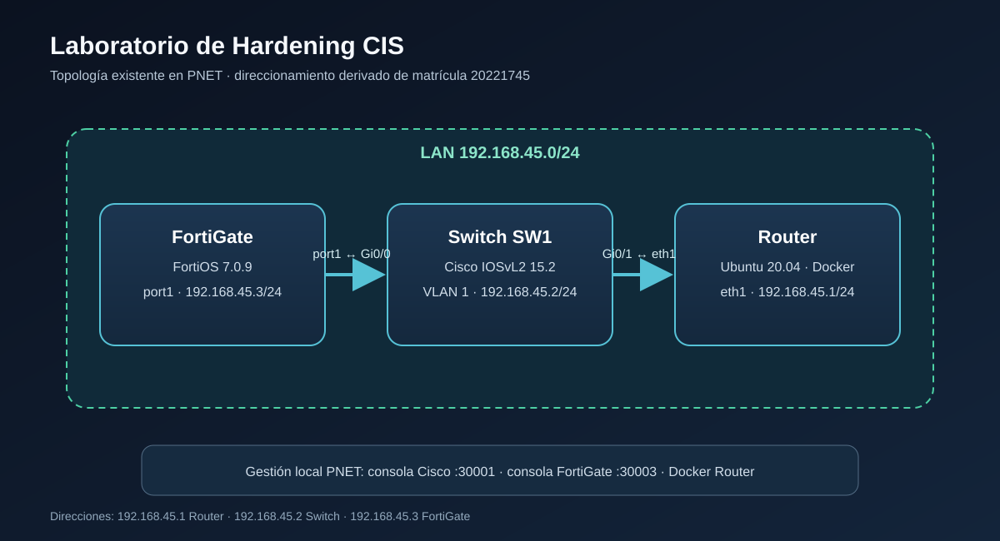
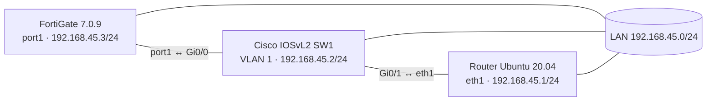

**Video demostrativo:** pendiente de grabación y publicación en YouTube. Este repositorio corresponde a la topología de esta asignación.

# Asignación 4 — Hardening CIS en PNET

**Autor:** Starlin Campusano · **Matrícula:** 20221745

## Propósito

Aplicar y verificar controles seleccionados de CIS en el firewall FortiGate, el switch Cisco IOSvL2 y el Router Ubuntu Docker ya presentes en PNET. Se usa la red `192.168.45.0/24`, derivada de los dos últimos dígitos de la matrícula. No se añadieron nodos.

## Topología





## Informe CIS automatizado

El script evalúa los controles escogidos en los tres equipos. Sin argumentos crea un informe **sin modificar** la configuración; con `--apply` aplica los cambios soportados y vuelve a auditar para crear un informe posterior.

```bash
python3 scripts/cis_hardening.py
python3 scripts/cis_hardening.py --apply
python3 scripts/cis_hardening.py --snapshot-dir configs
```

Ejecutarlo como `root` desde la VM PNET para consultar los nodos. Solicita la clave CLI de switch/FortiGate de forma interactiva; no la guarda ni la imprime. Informes Markdown y JSON quedan en `reports/`. La opción `--snapshot-dir configs` solo analiza los extractos saneados guardados, sin consultar ni modificar equipos.

## Contenido

- [`docs/controles-cis.md`](docs/controles-cis.md): propósito, controles, justificación y pruebas.
- [`docs/ejecucion.md`](docs/ejecucion.md): ejecución del escáner y modos de uso.
- [`docs/guion-video.md`](docs/guion-video.md): recorrido sugerido para la demostración.
- [`configs/`](configs/): running-configs saneados del FortiGate, Cisco IOSvL2 y Router, sin credenciales ni hashes.
- [`scripts/cis_hardening.py`](scripts/cis_hardening.py): auditoría y remediación idempotente seleccionada.
- [`reports/`](reports/): informes en vivo de solo lectura y posteriores a la aplicación.

## Alcance

El análisis automatizado cubre únicamente las recomendaciones seleccionadas y aplicables a las versiones de este laboratorio. Es un verificador propio inspirado en CIS Benchmarks; no es CIS-CAT ni representa una certificación o evaluación completa del benchmark. Las recomendaciones originales se enlazan en la documentación.

